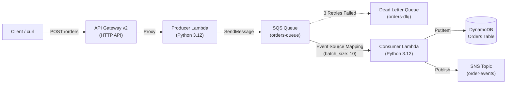

# Serverless Event-Driven Orders Pipeline (Terraform + Moto)

An asynchronous, serverless order processing architecture built with **Terraform** and tested offline against the **Moto AWS Emulator** running locally.

---

## 1. Architecture Overview



### Components
1. **API Gateway v2 (HTTP API)**: Exposes `POST /orders` with `$default` auto-deploy stage and Lambda proxy integration.
2. **Order Producer Lambda**: Validates incoming order requests, generates UUIDs and timestamps, and enqueues orders to SQS (`HTTP 202 Accepted`).
3. **SQS Queue with Dead Letter Queue (DLQ)**: Buffers orders with redrive policy (`maxReceiveCount = 3`).
4. **Order Consumer Lambda**: Triggered via SQS Event Source Mapping (`batch_size = 10`), processes orders, stores records in DynamoDB, and dispatches completion events to SNS.
5. **DynamoDB Table (`Orders`)**: Stores persistent order records keyed by `order_id` with timestamps and status.
6. **SNS Topic (`order-events`)**: Publishes event notifications for downstream subscribers.

---

## 2. Directory Structure

```
terraform-moto-lab/
├── provider.tf            # AWS & Archive providers pointing to Moto (http://127.0.0.1:5000)
├── variables.tf           # Environment, project name, DLQ maxReceiveCount, batch size
├── dynamodb.tf            # Orders table definition (PAY_PER_REQUEST billing)
├── sqs.tf                 # Orders queue + Dead Letter Queue (DLQ) with redrive policy
├── sns.tf                 # Order events SNS topic
├── lambda.tf              # Lambda packaging (archive_file), IAM roles, and ESM
├── apigateway.tf          # API Gateway v2 HTTP API, routes, and permissions
├── outputs.tf             # Resource URLs, ARNs, and table names
├── src/
│   ├── producer/
│   │   └── handler.py     # Producer Lambda handler (API Gateway -> SQS)
│   └── consumer/
│       └── handler.py     # Consumer Lambda handler (SQS -> DynamoDB + SNS)
├── test_pipeline.py       # End-to-end integration test suite
└── README.md              # Documentation and CLI snippets
```

---

## 3. Quick Start & Terraform Commands

Ensure the Moto emulator daemon is running:
```bash
aws-emulator status
# If stopped:
aws-emulator start
```

### Initialize & Deploy:
```bash
# 1. Initialize providers
terraform init

# 2. Preview resources
terraform plan

# 3. Apply infrastructure
terraform apply -auto-approve

# 4. View outputs
terraform output
```

---

## 4. End-to-End Verification

Run the automated integration test suite:
```bash
python3 test_pipeline.py
```

This verifies:
- DynamoDB table schema, status, and hash key.
- SQS main queue and DLQ redrive policy (`maxReceiveCount: 3`).
- SNS topic configuration.
- API Gateway v2 HTTP API and `POST /orders` route.
- Lambda configurations and active SQS Event Source Mapping.
- Producer Lambda execution & SQS message delivery.
- Consumer Lambda processing, DynamoDB record persistence, and SNS event dispatch.

---

## 5. Manual Verification with AWS CLI

Configure local environment variables for Moto:
```bash
export AWS_ACCESS_KEY_ID=mock_access_key
export AWS_SECRET_ACCESS_KEY=mock_secret_key
export AWS_DEFAULT_REGION=us-east-1
export ENDPOINT=http://127.0.0.1:5000
```

### DynamoDB:
```bash
# List tables
aws --endpoint-url $ENDPOINT dynamodb list-tables

# Scan orders
aws --endpoint-url $ENDPOINT dynamodb scan --table-name serverless-orders-orders
```

### SQS & DLQ:
```bash
# List queues
aws --endpoint-url $ENDPOINT sqs list-queues

# Inspect DLQ attributes
aws --endpoint-url $ENDPOINT sqs get-queue-attributes \
  --queue-url http://127.0.0.1:5000/123456789012/serverless-orders-orders-queue \
  --attribute-names RedrivePolicy ApproximateNumberOfMessages
```

### SNS:
```bash
# List topics
aws --endpoint-url $ENDPOINT sns list-topics
```

### Lambda & Event Source Mappings:
```bash
# List functions
aws --endpoint-url $ENDPOINT lambda list-functions --query 'Functions[*].FunctionName'

# List event source mappings
aws --endpoint-url $ENDPOINT lambda list-event-source-mappings
```

### API Gateway v2:
```bash
# List HTTP APIs
aws --endpoint-url $ENDPOINT apigatewayv2 get-apis
```

---

## 6. Teardown

To destroy the infrastructure:
```bash
terraform destroy -auto-approve
```
